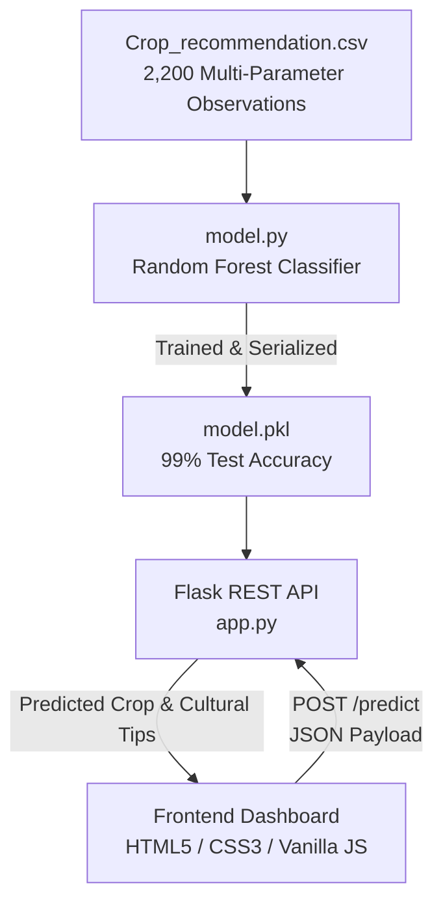

# Smart Crop Recommendation System

> **Precision Agriculture Platform Recommending Optimal Crops Using Machine Learning & Soil Chemistry**

[](https://python.org/)
[](https://flask.palletsprojects.com/)
[](https://scikit-learn.org/)
[](https://scikit-learn.org/)
[](LICENSE)

---

## Overview

Selecting the right crop for specific soil chemistry and meteorological conditions is critical for maximizing harvest yields and preventing soil exhaustion.

The **Smart Crop Recommendation System** uses an ensemble **Random Forest Classifier** trained on 2,200 agricultural soil and weather observations across 22 major crop species. Given local parameters—Nitrogen (N), Phosphorus (P), Potassium (K), Temperature, Humidity, Soil pH, and Rainfall—the system recommends the ideal crop to cultivate, delivering predictions via a Flask REST API and an intuitive, modern web dashboard.

---

## System Architecture



---

## Key Features

- **Multi-Factor Precision Agriculture:** Analyzes 7 vital soil and environmental metrics (N, P, K, Temperature, Relative Humidity, Soil pH, Precipitation).
- **High-Accuracy ML Model:** Utilizes Random Forest classification achieving over 99% accuracy on unseen test splits.
- **22 Supported Crops:** Covers cereals, legumes, fruits, and commercial crops (Rice, Wheat, Maize, Chickpea, Kidney Beans, Pigeon Peas, Moth Beans, Mung Bean, Black Gram, Lentil, Pomegranate, Banana, Mango, Grapes, Watermelon, Muskmelon, Apple, Orange, Papaya, Coconut, Cotton, Jute, Coffee).
- **Interactive UI:** Clean, responsive form with real-time field validation, animated loading indicators, and dynamic crop emoji/badge feedback.
- **Decoupled Architecture:** Clean separation between the machine learning pipeline, Flask microservice, and frontend assets.

---

## Project Structure

```
soil-project/
├── backend/
│   ├── app.py                     # Flask REST API endpoint (/predict)
│   ├── model.py                   # Model training and evaluation script
│   ├── requirements.txt           # Python dependencies
│   └── Crop_recommendation.csv    # Training dataset copy
├── frontend/
│   ├── index.html                 # Interactive recommendation UI
│   ├── script.js                  # Form validation and API client
│   └── style.css                  # UI styling and animations
├── Crop_recommendation.csv        # Master dataset (2,200 rows, 8 columns)
├── .gitignore                     # Git exclusions
└── README.md                      # System documentation
```

---

## Monitored Parameters

| Parameter | Unit | Agricultural Significance |
| :--- | :--- | :--- |
| **Nitrogen (N)** | Ratio in soil | Crucial for leaf growth and vegetative development |
| **Phosphorus (P)** | Ratio in soil | Stimulates root development and early plant vigor |
| **Potassium (K)** | Ratio in soil | Enhances disease resistance and drought tolerance |
| **Temperature** | °C | Ambient regional growing temperature |
| **Humidity** | % | Atmospheric relative humidity |
| **pH** | Scale 0–14 | Soil acidity or alkalinity affecting nutrient availability |
| **Rainfall** | mm | Annual / seasonal precipitation level | ---

## Quick Start & Installation

### 1. Prerequisites
- Python 3.9 or higher
- Modern web browser

### 2. Backend Setup
```bash
# Navigate to backend directory
cd soil-project/backend

# Create and activate virtual environment
python -m venv venv
# Windows:
venv\Scripts\activate
# Linux/macOS:
source venv/bin/activate

# Install dependencies
pip install -r requirements.txt
```

### 3. Train the Machine Learning Model
Generate `model.pkl` by running the training pipeline:
```bash
python model.py
```
*Expected Output:*
```
Accuracy: 99.32%
Model saved as model.pkl
```

### 4. Start the Flask API Server
```bash
python app.py
```
The REST API will launch at `http://127.0.0.1:5000`.

### 5. Launch the Frontend
Open `frontend/index.html` in your web browser:
1. Enter soil measurements (N, P, K, pH) and climate values (Temperature, Humidity, Rainfall).
2. Click **Recommend Crop**.
3. View the recommended crop and cultivation emoji indicator.

---

## API Reference

### Predict Recommended Crop
- **Endpoint:** `POST /predict`
- **Headers:** `Content-Type: application/json`
- **Request Body:**
  ```json
  {
    "N": 90,
    "P": 42,
    "K": 43,
    "temperature": 20.8,
    "humidity": 82.0,
    "ph": 6.5,
    "rainfall": 202.9
  }
  ```
- **Response:**
  ```json
  {
    "prediction": "rice"
  }
  ```

---

## License

This project is licensed under the [MIT License](LICENSE).
